<div align="center">

# n8n-hubspot-round-robin-pto-holiday-aware-balancer

**Intelligent lead assignment router that cross-references sales rep Google/Outlook calendar out-of-office states, PTO schedules, and current workloads before distributing incoming leads.**

A dhRobin Systems Revenue Infrastructure blueprint

     

</div>

---

## Table of Contents

1. [Overview](#1-overview)
2. [Architecture](#2-architecture)
3. [Repository Contents](#3-repository-contents)
4. [Prerequisites](#4-prerequisites)
5. [5-Minute Sandbox Quick Start](#5-5-minute-sandbox-quick-start)
6. [Environment Variables](#6-environment-variables)
7. [Node-by-Node Configuration Guide](#7-node-by-node-configuration-guide)
8. [Availability Providers](#8-availability-providers)
9. [Assignment Model](#9-assignment-model)
10. [Safety Matrix](#10-safety-matrix)
11. [Data Protection and Compliance](#11-data-protection-and-compliance)
12. [Deployment and Promotion Path](#12-deployment-and-promotion-path)
13. [Operations and Troubleshooting](#13-operations-and-troubleshooting)
14. [Disclaimer and License](#14-disclaimer-and-license)

---

## 1. Overview

Plain round-robin is fair on paper and wasteful in practice: it hands a hot lead to a rep who is on a beach, a rep whose country is on a public holiday, or a rep already buried under thirty untouched leads. I built this balancer to make the rotation aware of all three. Before a lead is assigned, every rep is checked against their calendar out-of-office state or PTO record, their regional holiday calendar and working hours, and their live HubSpot workload. Only then does a smooth weighted round-robin choose among the reps who can actually respond.

**The balancer runs in two modes:**

| Mode | Trigger | Selection |
|---|---|---|
| **Event** | HubSpot `contact.creation` webhook (or a form-driven workflow webhook posting `objectId`) | The new contacts, read with batch read |
| **Sweep** | Every 15 minutes, or Manual Test Trigger without an event | Ownerless contacts created within `SWEEP_LOOKBACK_HOURS` in `SWEEP_LIFECYCLE_STAGES` |

**Per run, the balancer:**

1. Verifies the HubSpot v3 signature, de-duplicates events, and ignores its own writes.
2. Normalises leads: validates the email, skips owned or already-balanced contacts, and derives territory and score tier.
3. Loads the rep roster (`REP_ROSTER`) and matches it to active HubSpot owners.
4. Counts each rep's workload in HubSpot: leads assigned today, open leads, open deals.
5. Checks availability through Microsoft Graph (`getSchedule`, status `oof`), Google Calendar (`outOfOffice` events), a PTO/HRIS API, or none. Holidays and working hours are applied from configuration.
6. Assigns with **smooth weighted round-robin**: territory pool → cross-territory pool → `FALLBACK_OWNER_EMAIL`.
7. Updates `hubspot_owner_id` plus `round_robin_*` audit properties, adds an assignment note, and emits an execution summary.

**Design principles**

| Principle | Implementation |
|---|---|
| Safe by default | With no environment variables set, the balancer makes **zero external API calls and zero CRM writes**. |
| Explainable decisions | Every assignment records its rule, pool and the reps skipped with their reason (`rep.beta:calendar_ooo`). |
| Capacity first | Daily, open-lead and open-deal caps are enforced, and assignments made earlier in the same run count toward them. |
| Fail visible, not silent | A failed workload count marks that rep at capacity. A failed calendar lookup follows `CALENDAR_FAILURE_POLICY`. No eligible rep and no valid fallback leaves the lead **unassigned** rather than guessing. |
| Owner respect | Owned contacts are never re-routed unless `REASSIGN_UNAVAILABLE_OWNER=true` and the owner is unavailable. |
| Secrets out of data | `HUBSPOT_PRIVATE_APP_TOKEN` and `CALENDAR_API_KEY` appear only as `{{ $env.* }}` in HTTP header fields. |

---

## 2. Architecture

```mermaid
flowchart LR
    T1[HubSpot: Contact<br/>Created Webhook] --> CFG
    T2[Unassigned Lead Sweep<br/>*/15 * * * *] --> CFG
    T3[Manual Test Trigger] --> SY[Build Synthetic<br/>Contact Events] --> CFG
    CFG[Config & Safety Gate<br/>$env → config.*] --> PV[Parse & Validate Events<br/>HMAC · loop guard · dedupe]
    PV --> SB{Sandbox Mode?}
    SB -- yes --> ML[Mock Lead Retrieval]
    SB -- no --> WM{Webhook Mode?}
    WM -- yes --> HW{Has Webhook<br/>Contacts?} -- yes --> BR[HubSpot: Batch<br/>Read Contacts]
    WM -- no --> SW[HubSpot: Search<br/>Unassigned Leads]
    ML --> NL[Normalize Leads<br/>territory · tier · validation]
    BR --> NL
    SW --> NL
    NL --> HL{Has Leads?}
    HL -- yes --> SR{Sandbox Reps?}
    SR -- yes --> MR[Mock Rep Context]
    SR -- no --> LO[HubSpot: List Owners] --> RQ[Build Rep<br/>Workload Queries]
    RQ --> C1[Count Assigned Today] --> C2[Count Open Leads] --> C3[Count Open Deals] --> CW[Collect Workload]
    CW --> CR[Build Calendar Requests]
    CR --> PM{microsoft?}
    PM -- yes --> GS[Microsoft Graph:<br/>Get Schedule]
    PM -- no --> PG{google?}
    PG -- yes --> GC[Google Calendar:<br/>OOO Events]
    PG -- no --> PP{pto_api?}
    PP -- yes --> PT[PTO API:<br/>List Time Off]
    PP -- no --> NA
    GS --> NA[Normalize Availability]
    GC --> NA
    PT --> NA
    MR --> EN[Weighted Round-Robin<br/>Assignment Engine]
    NA --> EN
    EN --> CP[Compose Assignment<br/>Payloads]
    CP --> DR{Dry Run?}
    DR -- no --> AL{Assign Leads?} -- yes --> UO[HubSpot: Batch Update<br/>Contact Owners] --> LN{Log Notes?} -- yes --> NT[HubSpot: Batch Create<br/>Assignment Notes]
    DR -- yes --> AU[Execution Summary<br/>& Audit]
    AL -- no --> AU
    LN -- no --> AU
    NT --> AU
    HW -- no --> AU
    HL -- no --> AU
```



### Stage contracts

| Stage | Output |
|---|---|
| Parse & Validate Events | `{ mode: "webhook" \| "sweep", contactIds[], counters, signature }` |
| Normalize Leads | `{ leads: [{ contactId, email, name, company, country, state, territory, score, tier, existingOwnerId }], skipped[], stats }` |
| Mock Rep Context / Normalize Availability | `{ provider, fallbackOwner, rosterMissing[], reps: [{ ownerId, email, name, active, workload: { assignedToday, openLeads, openDeals, error }, availability: { status, until, source, detail } }] }` |
| Weighted Round-Robin Assignment Engine | `{ decisions: [{ lead, rule, rep, ownerId, write, pool, skipped[] }], reps[], engine: { provider, eligibleReps[], excludedReps[], statePersisted } }` |
| Compose Assignment Payloads | `{ dryRun, assignLeads, counts, updateBatches[][], noteBatches[][], distribution, engine, decisions[] }` |
| Execution Summary & Audit | `{ outcome, mode, intake, leadValidation, skippedLeads, engine, counts, distribution, decisions, hubspot, finishedAt }` |

---

## 3. Repository Contents

```
n8n-hubspot-round-robin-pto-holiday-aware-balancer/
├── README.md        Technical documentation (this file)
├── workflow.json    Importable n8n workflow with sticky notes and pinned synthetic payloads
├── DISCLAIMER.md    Liability limitation and usage terms
└── LICENSE          MIT License
```

---

## 4. Prerequisites

| Requirement | Detail |
|---|---|
| n8n | Self-hosted **1.60 or later** (Webhook 2, Schedule Trigger 1.2, Set 3.4, IF 2, Code 2, HTTP Request 4.2, `v1` execution order). |
| Env access | `N8N_BLOCK_ENV_ACCESS_IN_NODE=false`. Recent n8n releases block `$env` in nodes by default, so set this explicitly. |
| Crypto in Code nodes | `NODE_FUNCTION_ALLOW_BUILTIN=crypto` for webhook signature verification. |
| HubSpot private app | Scopes `crm.objects.contacts.read`, `crm.objects.contacts.write`, `crm.objects.deals.read`, `crm.objects.owners.read`, plus the write scope HubSpot lists for the Notes API. For event mode, a webhook subscription to `contact.creation` and the app's client secret. |
| HubSpot properties | Five custom contact properties (see [§7.12](#712-hubspot-custom-contact-properties)). |
| Availability provider | One of the following (see [§8](#8-availability-providers)): Microsoft Graph, Google Calendar, an internal PTO/HRIS API, or none. |
| Token handling | **Google Calendar and Microsoft Graph require OAuth 2.0 access tokens, not static API keys.** `CALENDAR_API_KEY` is sent as `Authorization: Bearer …`, so it must hold a currently valid access token, refreshed by a token broker or your secret manager. For a PTO API that uses static keys, put the key there directly. |

> **n8n Cloud:** you can't define your own environment variables on n8n Cloud. Replace each `$env.X` with `$vars.X` (on plans with Variables), or move the calendar authentication into an n8n OAuth2 credential, which also handles token refresh. The node logic is unchanged.

---

## 5. 5-Minute Sandbox Quick Start

1. **Run n8n locally:**
   ```bash
   docker run -it --rm -p 5678:5678 \
     -e N8N_BLOCK_ENV_ACCESS_IN_NODE=false \
     -e NODE_FUNCTION_ALLOW_BUILTIN=crypto \
     -e GENERIC_TIMEZONE=UTC \
     -v n8n_data:/home/node/.n8n \
     docker.n8n.io/n8nio/n8n
   ```
2. **Import** `workflow.json` (*Workflows → Import from File*).
3. Click **Test workflow** on *Manual Test Trigger*.
4. Open **Weighted Round-Robin Assignment Engine** and **Execution Summary & Audit**.

**Expected sandbox result** (8 synthetic contacts and 7 synthetic reps, no credentials, nothing sent):

| Rep | Status |
|---|---|
| `rep.alpha` | Available (weight 1) |
| `rep.beta` | Excluded: `calendar_ooo` |
| `rep.gamma` | Excluded: `pto` |
| `rep.delta` | Excluded: `daily_capacity_reached` (25/25) |
| `rep.epsilon` | Excluded: `holiday_IN` (a synthetic holiday dated today in Asia/Kolkata) |
| `rep.zeta` | Available (weight 2) |
| `rep.eta` | Available (EMEA) |

| Lead | Territory | Result |
|---|---|---|
| Jordan Smith (US) | NA | `rep.zeta`: territory weighted round-robin |
| Avery Lane (US, score 82 → high) | NA | `rep.alpha` |
| Rowan Price, Morgan Hale (US) | NA | `rep.zeta` (2:1 weighting) |
| Elena Voss (DE) | EMEA | `rep.eta` |
| Kenji Mori (JP) | APAC | The only APAC rep is on holiday → **cross-territory** round-robin → `rep.zeta` |
| Dana Cole | — | Skipped: `already_owned` |
| Sky Rivera | — | Skipped: `invalid_email` |

A duplicate delivery is dropped. With `HUBSPOT_APP_ID=5400001`, the balancer's own `hubspot_owner_id` change event is ignored by the loop guard.

---

## 6. Environment Variables

All variables are optional. Unset values resolve to the safest behaviour.

### 6.1 Safety gate

| Variable | Default | Behaviour |
|---|---|---|
| `SANDBOX_MODE` | `true` | Any value except `false` uses synthetic leads, reps, workload and availability. Zero external calls. |
| `DRY_RUN` | `true` | Any value except `false` computes decisions and ends at the audit node. |
| `ASSIGN_LEADS` | `false` | Must be exactly `true` (with `DRY_RUN=false`) to update owners. |
| `LOG_ASSIGNMENT_NOTES` | `true` | Effective only with `ASSIGN_LEADS=true`. Adds a timeline note per assignment. |
| `REQUIRE_HUBSPOT_SIGNATURE` | `true` | Any value except `false` rejects unsigned webhook requests. Skipped only in sandbox. |

### 6.2 Roster and capacity

| Variable | Default | Description |
|---|---|---|
| `REP_ROSTER` | *(sandbox: synthetic)* | JSON array, **required outside sandbox**: `[{"email":"rep.alpha@example.com","weight":1,"territories":["NA"],"tiers":["high","standard"],"region":"US","timezone":"America/New_York","maxDailyLeads":25,"maxOpenLeads":40,"maxOpenDeals":0}]`. `territories` may include `"*"`. `tiers` defaults to both. Per-rep limits override the globals. |
| `FALLBACK_OWNER_EMAIL` | `sales.fallback@example.com` | Owner used when no rep is eligible. It must be an active HubSpot owner, otherwise leads stay unassigned. |
| `MAX_DAILY_LEADS_PER_REP` | `25` | Leads assigned by the balancer per rep per UTC day. |
| `MAX_OPEN_LEADS_PER_REP` | `40` | Open leads owned (`OPEN_LEAD_STAGES`). `0` disables the cap. |
| `MAX_OPEN_DEALS_PER_REP` | `0` (off) | Open deals owned. `0` disables the cap. |
| `OPEN_LEAD_STAGES` | `lead,marketingqualifiedlead,salesqualifiedlead` | Lifecycle stages counted as open leads. |
| `REP_UNAVAILABLE_EMAILS` | *(empty)* | Manual override list (sick leave, training, etc.). |

### 6.3 Territory and tiers

| Variable | Default | Description |
|---|---|---|
| `TERRITORY_RULES` | *(sandbox: NA, EMEA, APAC)* | JSON array, first match wins: `[{"name":"NA","countries":["US","CA"]},{"name":"US-East","countries":["US"],"states":["NY","MA"]}]`. Unmatched leads get territory `unmatched`. |
| `ALLOW_CROSS_TERRITORY` | `true` | When a territory pool has no eligible rep, rotate across all eligible reps before using the fallback owner. |
| `HIGH_SCORE_THRESHOLD` | `70` | `hubspotscore` at or above this makes the lead tier `high`. Reps without `high` in `tiers` never receive these leads. |

### 6.4 Availability

| Variable | Default | Description |
|---|---|---|
| `CALENDAR_PROVIDER` | `none` | `microsoft`, `google`, `pto_api` or `none`. |
| `CALENDAR_API_KEY` | — | **Secret.** OAuth access token (Graph and Google) or API key (PTO API), sent as `Authorization: Bearer`. |
| `CALENDAR_ORGANIZER_UPN` | *(empty)* | Microsoft only: the mailbox that runs `getSchedule`, for example `scheduler@company.example`. |
| `PTO_API_URL` | *(empty)* | PTO API only: endpoint returning time-off entries (contract in [§8.3](#83-pto--hris-api-pto_api)). |
| `AVAILABILITY_WINDOW_HOURS` | `4` | A rep is unavailable if OOO or PTO overlaps `[now, now + window]`. |
| `CALENDAR_FAILURE_POLICY` | `assume_available` | When a lookup fails for a rep: `assume_available` (keeps leads flowing, flagged as `unknown`) or `exclude`. |
| `HOLIDAY_CALENDAR` | *(sandbox: synthetic)* | JSON map of region → ISO dates, evaluated on the **rep's local date**: `{"US":["2026-11-26","2026-12-25"],"DE":["2026-12-25","2026-12-26"],"IN":["2026-11-08"]}`. |
| `WORKING_HOURS` | `08:00-18:00` | Rep-local working window. |
| `WORKING_DAYS` | `1,2,3,4,5` | Rep-local working days (0 = Sunday). |
| `OFF_HOURS_POLICY` | `ignore` | `exclude` removes reps outside their working hours or days. `ignore` assigns anyway, for next-morning follow-up. |

### 6.5 Intake and endpoints

| Variable | Default | Description |
|---|---|---|
| `REASSIGN_UNAVAILABLE_OWNER` | `false` | Re-route owned contacts when the current owner is ineligible. |
| `SWEEP_LOOKBACK_HOURS` | `24` | Sweep window for ownerless contacts. |
| `SWEEP_LIFECYCLE_STAGES` | `subscriber,lead,marketingqualifiedlead` | Sweep filter. |
| `MAX_LEADS_PER_RUN` | `100` | 1–100 (one batch). |
| `HUBSPOT_APP_ID` | *(empty)* | Events with this `sourceId` (the balancer's own writes) are ignored. |
| `HUBSPOT_WEBHOOK_PUBLIC_URL` | *(webhook URL)* | Exact public URL used for v3 signatures behind proxies. |
| `HUBSPOT_APP_CLIENT_SECRET` | — | **Secret.** Read in memory for the HMAC check only, never output. This is the single sanctioned exception, because an HMAC can't be computed in a header field. |
| `HUBSPOT_PRIVATE_APP_TOKEN` | — | **Secret.** `Authorization: Bearer` on every HubSpot request. |
| `HUBSPOT_API_BASE_URL` | `https://api.hubapi.com` | API base. |

### 6.6 Sample `.env` (staging)

```dotenv
# n8n runtime
N8N_BLOCK_ENV_ACCESS_IN_NODE=false
NODE_FUNCTION_ALLOW_BUILTIN=crypto
GENERIC_TIMEZONE=UTC

# Safety gate: live reads against a HubSpot test portal, nothing written yet
SANDBOX_MODE=false
DRY_RUN=true
ASSIGN_LEADS=false
REQUIRE_HUBSPOT_SIGNATURE=true

# Secrets (inject from your secret manager; never commit)
HUBSPOT_PRIVATE_APP_TOKEN=replace-with-test-portal-token
HUBSPOT_APP_CLIENT_SECRET=replace-with-app-client-secret
CALENDAR_API_KEY=replace-with-current-oauth-access-token

# Roster and routing
REP_ROSTER=[{"email":"rep.alpha@example.com","weight":1,"territories":["NA"],"region":"US","timezone":"America/New_York"},{"email":"rep.zeta@example.com","weight":2,"territories":["NA"],"region":"US","timezone":"America/Los_Angeles"},{"email":"rep.eta@example.com","territories":["EMEA"],"region":"DE","timezone":"Europe/Berlin"}]
TERRITORY_RULES=[{"name":"NA","countries":["US","CA"]},{"name":"EMEA","countries":["DE","GB","FR"]}]
FALLBACK_OWNER_EMAIL=sales.fallback@example.com
MAX_DAILY_LEADS_PER_REP=25
MAX_OPEN_LEADS_PER_REP=40

# Availability
CALENDAR_PROVIDER=microsoft
CALENDAR_ORGANIZER_UPN=scheduler@company.example
AVAILABILITY_WINDOW_HOURS=4
HOLIDAY_CALENDAR={"US":["2026-11-26","2026-12-25"],"DE":["2026-12-25","2026-12-26"]}
OFF_HOURS_POLICY=ignore
HUBSPOT_APP_ID=5400001
```

---

## 7. Node-by-Node Configuration Guide

### 7.1 Triggers
| Node | Detail |
|---|---|
| HubSpot: Contact Created Webhook | `POST /webhook/hubspot/lead-assignment`, responds 200 immediately. Subscribe your app to `contact.creation`. Form-driven HubSpot workflows can post `{ "objectId": … }` with a *Send a webhook* action instead. **Pinned:** 8 synthetic `contact.creation` events. |
| Unassigned Lead Sweep | Cron `*/15 * * * *`: assigns ownerless leads the webhook missed (outages, imports). **Pinned.** |
| Manual Test Trigger → Build Synthetic Contact Events | 10 fictitious events, including a duplicate and a self-inflicted change. |

The workflow imports **inactive**. Activate it only after completing [§12.2](#122-promotion-path).

### 7.2 Config & Safety Gate
Set v3.4 with *Include Other Fields*. It holds typed, non-secret configuration under `config.*`. Safety flags stay on unless set to exactly `false`, write flags stay off unless set to exactly `true`, enumerations fall back to safe defaults, and numbers are clamped.

### 7.3 Parse & Validate Events
This node selects the mode, verifies the HubSpot v3 signature (HMAC-SHA256, `timingSafeEqual`, 5-minute window), drops events whose `sourceId` equals `HUBSPOT_APP_ID`, keeps `contact.creation` and workflow webhooks, and de-duplicates contact IDs. Counters: `received`, `ignoredType`, `selfInflicted`, `duplicate`, `accepted`.

### 7.4 Lead retrieval
- **Webhook mode:** `POST /crm/v3/objects/contacts/batch/read` (≤ 100 IDs). **Pinned.**
- **Sweep mode:** `POST /crm/v3/objects/contacts/search` with `hubspot_owner_id NOT_HAS_PROPERTY`, `createdate ≥ now − SWEEP_LOOKBACK_HOURS` and `lifecyclestage IN SWEEP_LIFECYCLE_STAGES`, oldest first. **Pinned.**
- Properties read: `email`, `firstname`, `lastname`, `company`, `country`, `state`, `hubspotscore`, `lifecyclestage`, `hubspot_owner_id`, `createdate`, `round_robin_assigned_at`.

### 7.5 Normalize Leads
| Check | Effect |
|---|---|
| Email fails syntax validation | Skipped (`invalid_email`) |
| `round_robin_assigned_at` set | Skipped (`already_assigned_by_balancer`). Prevents double routing |
| Owner present and `REASSIGN_UNAVAILABLE_OWNER=false` | Skipped (`already_owned`) |
| Territory | First matching `TERRITORY_RULES` entry, otherwise `unmatched` |
| Tier | `high` when `hubspotscore ≥ HIGH_SCORE_THRESHOLD`, otherwise `standard` |

### 7.6 HubSpot: List Owners → Build Rep Workload Queries
- `GET /crm/v3/owners?limit=500&archived=false`. **Pinned:** 7 reps and the fallback queue.
- `REP_ROSTER` emails are matched to active owners. Unmatched emails are reported in `rosterMissing`. If nothing matches, the run fails.
- Each rep gets three CRM Search bodies (`limit: 1`, only `total` is read).

### 7.7 Workload counts → Collect Workload
| Node | Query |
|---|---|
| HubSpot: Count Assigned Today | Contacts with `hubspot_owner_id = rep` and `round_robin_assigned_at ≥ 00:00 UTC` |
| HubSpot: Count Open Leads | Contacts with `hubspot_owner_id = rep` and `lifecyclestage IN OPEN_LEAD_STAGES` |
| HubSpot: Count Open Deals | Deals with `hubspot_owner_id = rep` and `hs_is_closed = false` |

The counts are sent at 4 requests per second, within CRM Search limits, with 3 retries. *Collect Workload* joins them by index and **fails the run on a count mismatch**. A failed individual count marks that rep `workload_unknown`, which excludes them. **Pinned:** 7 responses each.

### 7.8 Build Calendar Requests → provider gates → Normalize Availability
See [§8](#8-availability-providers). Only the configured provider's node executes. Its response is normalised to `available`, `ooo`, `pto` or `unknown` per rep. **Pinned:** a Graph schedule (Beta `oof`), Google events (Beta `outOfOffice`) and PTO entries (Gamma vacation).

### 7.9 Weighted Round-Robin Assignment Engine
See [§9](#9-assignment-model).

### 7.10 Compose → Dry Run? → Assign Leads? → owners → notes
- **Contact batch update** (`POST /crm/v3/objects/contacts/batch/update`): `hubspot_owner_id`, `round_robin_assigned_at`, `round_robin_rule`, `round_robin_rep_email`, `round_robin_pool`, `round_robin_skipped_reps`.
- **Assignment notes** (`POST /crm/v3/objects/notes/batch/create`, note → contact `202`): rep, rule, pool, territory, tier, score and skipped reps.
- **Gates:** `DRY_RUN` not `false` → audit only. *Assign Leads?* requires `ASSIGN_LEADS=true` and at least one assignment. Notes follow `LOG_ASSIGNMENT_NOTES`. **Pinned:** synthetic `COMPLETE` responses.

### 7.11 Execution Summary & Audit
One record per run: `outcome` (`no_leads`, `no_eligible_leads`, `dry_run`, `assignment_disabled`, `nothing_to_assign` or `assigned`), intake counters, lead validation, excluded reps with reasons, per-lead decisions, distribution per rep, and HubSpot write counts. It is also logged as `[round-robin-balancer] {…}` (no lead emails).

### 7.12 HubSpot custom contact properties

| Internal name | Field type | Values |
|---|---|---|
| `round_robin_assigned_at` | Date and time | Drives `assignedToday` and the double-routing guard |
| `round_robin_rule` | Dropdown select | `territory_weighted_round_robin`, `cross_territory_weighted_round_robin`, `fallback_owner` |
| `round_robin_rep_email` | Single-line text | Assigned rep |
| `round_robin_pool` | Single-line text | Territory pool, or `global` |
| `round_robin_skipped_reps` | Multi-line text | `rep:reason` pairs (≤ 500 characters) |

**Useful report:** assignments per rep per week by `round_robin_rule`. A rising `fallback_owner` share means the roster or capacity needs attention.

---

## 8. Availability Providers

### 8.1 Microsoft Graph (`microsoft`)
- `POST https://graph.microsoft.com/v1.0/users/{CALENDAR_ORGANIZER_UPN}/calendar/getSchedule`, with one request for all reps (`schedules: [emails]`, a UTC window, `availabilityViewInterval: 30`).
- A rep is **`ooo`** when any `scheduleItems[].status` is `oof` and overlaps the window. Busy meetings don't exclude a rep.
- Per-schedule errors, for example a mailbox outside the tenant, become `unknown`.
- **Auth:** an Entra ID app with calendar read permission (typically `Calendars.Read`, scoped with an application access policy). Use a short-lived access token in `CALENDAR_API_KEY`. Confirm the required permission in Microsoft's documentation for your tenant.

### 8.2 Google Calendar (`google`)
- `GET https://www.googleapis.com/calendar/v3/calendars/{repEmail}/events?eventTypes=outOfOffice&singleEvents=true&timeMin=…&timeMax=…`, with one request per rep (5 per second).
- A rep is **`ooo`** when an `outOfOffice` event overlaps the window.
- **Auth:** an OAuth token with calendar read scope that can read each rep's calendar, typically a Workspace service account with domain-wide delegation. Confirm scopes in Google's documentation.

### 8.3 PTO / HRIS API (`pto_api`)
`GET {PTO_API_URL}?start=<ISO>&end=<ISO>` with `Authorization: Bearer {{ $env.CALENDAR_API_KEY }}`. Expected response:
```json
{ "entries": [ { "email": "rep.gamma@example.com", "start": "2026-11-14T00:00:00Z", "end": "2026-11-24T00:00:00Z", "type": "vacation", "approved": true } ] }
```
`timeOff` or `data` are accepted in place of `entries`, `employeeEmail` in place of `email`, and `startDate`/`endDate` in place of `start`/`end`. Entries with `approved: false` are ignored. An overlapping entry makes the rep **`pto`**. Most HR systems need a thin adapter to produce this shape.

### 8.4 None (`none`)
No external call. Holidays, working hours, capacity and `REP_UNAVAILABLE_EMAILS` still apply.

### 8.5 Holidays and working hours (all providers)
- **Holidays:** a rep is excluded (`holiday_<REGION>`) when their rep-local date (from `timezone`) is listed under their `region` in `HOLIDAY_CALENDAR`.
- **Working hours:** computed in the rep's timezone from `WORKING_HOURS` and `WORKING_DAYS`. Enforced only with `OFF_HOURS_POLICY=exclude`.

---

## 9. Assignment Model

### 9.1 Eligibility
A rep is eligible only when **none** of these exclusions apply:

| Exclusion | Source |
|---|---|
| `inactive_owner` | Not an active HubSpot owner |
| `manually_unavailable` | `REP_UNAVAILABLE_EMAILS` |
| `calendar_ooo` | Graph `oof` or a Google `outOfOffice` event in the window |
| `pto` | PTO API entry in the window |
| `availability_unknown` | Lookup failed and `CALENDAR_FAILURE_POLICY=exclude` |
| `holiday_<REGION>` | `HOLIDAY_CALENDAR` on the rep-local date |
| `outside_working_hours` | `OFF_HOURS_POLICY=exclude` |
| `workload_unknown` | A HubSpot count failed |
| `daily_capacity_reached` | `assignedToday ≥ maxDailyLeads` |
| `open_lead_capacity_reached` | `openLeads ≥ maxOpenLeads` (when > 0) |
| `open_deal_capacity_reached` | `openDeals ≥ maxOpenDeals` (when > 0) |

During a run, each assignment increments the rep's in-run count, so capacity holds across a batch.

### 9.2 Decision order per lead
| Step | Rule | Pool |
|---|---|---|
| 1 | `kept_existing_owner` | Only with `REASSIGN_UNAVAILABLE_OWNER=true`: the current owner is eligible, or is not a roster rep, so no change is made |
| 2 | `territory_weighted_round_robin` | Eligible reps whose `territories` include the lead's territory (or `*`) and whose `tiers` include the lead's tier |
| 3 | `cross_territory_weighted_round_robin` | `ALLOW_CROSS_TERRITORY`: all eligible reps whose tiers match |
| 4 | `fallback_owner` | `FALLBACK_OWNER_EMAIL`, if it is an active owner |
| 5 | `unassigned_no_available_rep` | Nothing is written. The audit lists the lead for a person to handle |

### 9.3 Smooth weighted round-robin
Each pool keeps a current weight per rep. On every pick, each eligible rep's current weight is increased by its `weight`, the highest is chosen, and the chosen rep's current weight is reduced by the total weight. With weights 2:1, the sequence is `Z, A, Z, Z, A, Z…`: proportional and interleaved, never in bursts. Reps that become ineligible are dropped from the pool state, and the rotation continues seamlessly when they return.

State persists **per territory** (high and standard leads share the rotation, and the tier only narrows the candidate set) in workflow static data, for **production executions only**. Sandbox and manual runs use throwaway state.

---

## 10. Safety Matrix

| `SANDBOX_MODE` | `DRY_RUN` | `ASSIGN_LEADS` | `CALENDAR_PROVIDER` | HubSpot read | Calendar / PTO call | Owner update | Notes |
|:---:|:---:|:---:|:---:|:---:|:---:|:---:|:---:|
| `true` *(default)* | `true` *(default)* | `false` *(default)* | any | No (mock) | No (mock) | No | No |
| `false` | `true` | any | `none` | Yes | No | No | No |
| `false` | `true` | any | `microsoft` / `google` / `pto_api` | Yes | Yes | No | No |
| `false` | `false` | `false` | any | Yes | As configured | No | No |
| `false` | `false` | `true` | any | Yes | As configured | **Yes** | **Yes**¹ |

¹ Unless `LOG_ASSIGNMENT_NOTES=false`.

**Pinned data:** pins apply only to manual executions. Production webhook and sweep executions always call live endpoints according to this matrix. Unpin a node (*right-click → Unpin*) before a manual live test of that integration. The workload count pins hold exactly 7 responses, matching the sample `REP_ROSTER` in [§12.2](#122-promotion-path). With a different roster, the count guard stops the run rather than misattributing workloads.

---

## 11. Data Protection and Compliance

| Data element | Read | Written | Logged |
|---|:---:|:---:|:---:|
| Lead email, name, company, country, state, score | HubSpot | Owner and `round_robin_*` only | Contact IDs only |
| Rep calendar | **Only OOO / `oof` status and times** (Graph also returns the schedule items it uses for this) | No | Status and reason only |
| Rep PTO | Entries in the window (type, dates) | No | Status only |
| Rep workload counts | HubSpot totals | No | Yes |

**My recommendations before going live**

- **Rep transparency:** tell sales reps that their calendar OOO and PTO status is used for lead routing. Agree it with HR or works councils where required.
- **Least privilege:** grant the narrowest calendar permission that exposes availability. For Graph, scope application access to the sales mailboxes only. Never grant mail access.
- **Token hygiene:** issue short-lived OAuth tokens through a broker, rotate the HubSpot token and app secret, and never log tokens.
- **Fairness review:** review the distribution report monthly. Weighting and capacity settings affect reps' earnings opportunities.
- **Retention:** restrict access to n8n executions, which contain lead and availability data, and enable pruning (`EXECUTIONS_DATA_PRUNE=true`, short `EXECUTIONS_DATA_MAX_AGE`).

---

## 12. Deployment and Promotion Path

### 12.1 Docker Compose

```yaml
services:
  n8n:
    image: docker.n8n.io/n8nio/n8n:latest   # pin a tested version tag in production
    restart: unless-stopped
    ports:
      - "5678:5678"
    env_file:
      - ./.env                              # never commit this file
    environment:
      - N8N_BLOCK_ENV_ACCESS_IN_NODE=false
      - NODE_FUNCTION_ALLOW_BUILTIN=crypto
      - WEBHOOK_URL=https://n8n.company.example/
      - EXECUTIONS_DATA_PRUNE=true
      - EXECUTIONS_DATA_MAX_AGE=168
      - N8N_ENCRYPTION_KEY=${N8N_ENCRYPTION_KEY}
    volumes:
      - n8n_data:/home/node/.n8n
volumes:
  n8n_data:
```

### 12.2 Promotion path

| Stage | Environment | Configuration | Exit criteria |
|---|---|---|---|
| 1. Sandbox | Any n8n instance | Defaults | The tables in [§5](#5-5-minute-sandbox-quick-start) are reproduced. |
| 2. Pinned live path | Same | `SANDBOX_MODE=false`, `DRY_RUN=false`, `ASSIGN_LEADS=true`, `REQUIRE_HUBSPOT_SIGNATURE=false`, a 7-rep `REP_ROSTER` (`rep.alpha` … `rep.eta`), `TERRITORY_RULES`, `HOLIDAY_CALENDAR`. Run once per `CALENDAR_PROVIDER` from the webhook node | Every node executes. Graph and Google exclude Beta, the PTO API excludes Gamma, `outcome: assigned`. |
| 3. Live reads | HubSpot test portal, pins removed | `DRY_RUN=true`, real roster, `CALENDAR_PROVIDER` with a real token | Workload counts match HubSpot views. OOO and PTO states match reality for every rep. |
| 4. Writes | Test portal | `DRY_RUN=false`, `ASSIGN_LEADS=true` | Owners and notes are correct. A second webhook for the same contact is skipped (`already_assigned_by_balancer`). |
| 5. Webhook | Test portal + public URL | Signature on, `HUBSPOT_APP_ID`, workflow active | A new form submission is assigned within seconds. The balancer's own owner change doesn't re-trigger it. |
| 6. Production | Production portal | Production roster, holiday calendars for every region | Two weeks of distribution reviewed with sales leadership. |

### 12.3 Version control hygiene

```bash
grep -nE '(pat-[a-z0-9]|ya29\.[A-Za-z0-9_-]{20,}|eyJ[A-Za-z0-9_-]{20,}\.|Bearer [A-Za-z0-9._-]{20,})' workflow.json && echo "Possible secret found" || echo "Clean"
```

---

## 13. Operations and Troubleshooting

### 13.1 Call volume per run
| Step | Calls |
|---|---|
| Lead read / sweep | 1 |
| Owners | 1 |
| Workload counts | 3 × reps (4 per second) |
| Availability | Graph 1 · Google 1 per rep · PTO 1 · none 0 |
| Writes | 1–2 batches |

A 10-rep roster with Graph means 34 calls and about 9 seconds of rate-limited counting. With frequent webhooks, consider caching workload per minute, or relying on the sweep for bursts.

### 13.2 Troubleshooting

| Symptom | Cause | Resolution |
|---|---|---|
| `access to env vars denied` | Env access blocked | Set `N8N_BLOCK_ENV_ACCESS_IN_NODE=false` and restart n8n. |
| `REP_ROSTER is empty` | No roster outside sandbox | Define `REP_ROSTER`. |
| `No REP_ROSTER email matches an active HubSpot owner` | Email mismatch or archived owners | Compare with *HubSpot: List Owners*. |
| `Workload count mismatch` | Pinned counts don't match the roster | Unpin the count nodes, or use the 7-rep sample roster for pinned tests. |
| Every rep `availability_unknown` | Expired OAuth token | Refresh `CALENDAR_API_KEY`. With `assume_available`, leads keep flowing in the meantime. |
| Graph `403` / `ErrorAccessDenied` | Missing permission or application access policy | Grant calendar read for the sales mailboxes. |
| Google `404` for a rep | No delegation to that calendar | Configure domain-wide delegation, or share the calendar. |
| Rep on holiday still assigned | Wrong `region` or date format | Use ISO `YYYY-MM-DD` and the same region code as `REP_ROSTER`. |
| Everything goes to the fallback owner | All reps excluded | Check `engine.excludedReps`. Usually it's capacity or a calendar outage with `exclude`. |
| Leads `unassigned_no_available_rep` | Fallback owner invalid | Set `FALLBACK_OWNER_EMAIL` to an active owner. |
| Uneven distribution | Weights, caps or manual-run state | Check `distribution`. Rotation persists only in production executions. |
| HubSpot `400` on update | Missing `round_robin_*` properties | Create them as described in [§7.12](#712-hubspot-custom-contact-properties). |

---

## 14. Disclaimer and License

### ⚠️ Disclaimer & Liability Limitation

**Use at your own risk.** The code, workflows, and scripts in this repository (`n8n-hubspot-round-robin-pto-holiday-aware-balancer`) are provided for educational and architectural demonstration purposes.

- **No Liability:** The author and dhRobin Systems accept no responsibility or liability for any direct, indirect, incidental, or consequential damages that result from using, misusing, or deploying these scripts.
- **No Warranty:** All software, n8n JSON blueprints, JavaScript modules and prompts are provided "AS IS", without warranty of any kind, express or implied. This includes, but is not limited to, warranties of merchantability, fitness for a particular purpose, and non-infringement.
- **Production Testing Required:** Always test thoroughly in an isolated staging environment, such as a HubSpot developer test account or sandbox, with `SANDBOX_MODE=true`, `DRY_RUN=true` and `ASSIGN_LEADS=false` enabled, before you connect live HubSpot or Google/Outlook calendar credentials. Treat every automated assignment as an operational decision that your sales leadership must monitor and be able to correct.
- **Third-Party APIs & Compliance:** You alone are responsible for complying with the terms of service, rate limits, data privacy regulations (GDPR/CCPA), and security policies of HubSpot, Google Calendar, Microsoft Graph / Outlook, your PTO or HR system and any connected services. That includes informing sales reps how their calendar and time-off data is used, granting only the minimum calendar permissions, securing every OAuth token and API key, reviewing distribution fairness, and reviewing every automatically created or updated record.

The full disclaimer is also available in [DISCLAIMER.md](DISCLAIMER.md).

### License

Released under the MIT License. Copyright (c) 2026 DH Robin (dhRobin Systems). See [LICENSE](LICENSE).

---

Full text: DISCLAIMER.md · Licensed under the MIT License. License: MIT © 2026 dhRobin Systems · Provided as-is, see the disclaimer.
